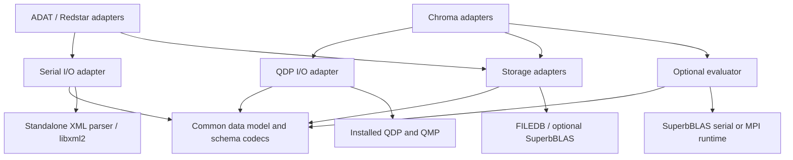

# Historical standalone datalib extraction design

> **Historical design snapshot (4–6 November 2026); superseded.**
> This preserves the original proposal and early phase gates, not current build
> instructions or pending approvals. Later reorg work established standalone
> datalib without ADAT or QDP dependencies, removed compatibility headers and
> Stich support, and completed Chroma and MPI validation. Proposed QDP-dependent
> datalib targets, `--without-qdp` options, `src/` layout and integration holds
> below are historical. Current architecture, builds and evidence are maintained
> in [datalib's reorg documentation](https://github.com/JeffersonLab/datalib/tree/rge/devel-datalib-reorg/docs/reorg).
> Kanoni devel and its accepted regression baselines are unchanged.

**Boundaries approved; first serial checkpoint authorized 5 November 2026.**

The isolated workspace is `/Users/admin/Downloads/macos-datalib-reorg`, with
all repositories on `rge/devel-datalib-reorg`. The first primitive/XML-codec
and container extraction checkpoint builds standalone datalib and ADAT using
an explicit configure dependency with OpenMP. The 6 November checkpoint
moves the graph models and serial format-3 and format-4 codecs into datalib.
ADAT retains its existing graph header and links the extracted implementation.
The first storage slice moves the version-0 correlator container into datalib
and preserves ADAT's source API through a forwarding header. The FILEDB slice
adds standalone key and value serializers and database open helpers with an
optional `--with-filedb=PREFIX` dependency. ADAT uses the shared adapter with
its bundled FILEDB provider.
The evaluator, QDP, Chroma integration and merges remain on hold.
See [the checkpoint record](datalib-serial-checkpoint.md) for validation.
The remaining phases below describe future work.

This proposes one standalone source package, provisionally named `datalib`,
consumed by Chroma and ADAT/Redstar. It supplies serial and QDP builds without
requiring an ADAT installation to build Chroma. Existing formats and physics
conventions remain unchanged. The package name, repository location and API
spelling below are proposals, not existing supported commands.

The earlier [clean numerical run](no1pt-clean-build.md) used an Eloy-based ADAT
stack. It does not validate canonical ADAT or this extraction. Neither that
source tree nor canonical ADAT is to be merged wholesale into the new package.
The earlier backend-choice question is superseded by this standalone design.

## 1. Source baseline and inspected dependencies

The [machine-readable inventory](datalib-dependency-inventory.json) records
commits, file hashes, source groups, resolved include edges, external includes,
and preservation anchors. Source identifiers in this document use
`repository:relative/path` notation.

| Inspected source | Commit | Role |
| --- | --- | --- |
| Canonical ADAT `origin/devel-rge-no_1pt` | `161bc77dac89c1f7474a370ecbef5b8846b0b0b5` | Format-4 codec, current utilities and compatibility behavior |
| Historical Eloy-based ADAT plus backports | `817f7e200aa29fa4474c7ac4eeda0658af08869d` | Working evaluator/storage implementation to inventory, not canonical branch |
| Experimental Chroma | `1628765976513d8b71ba210ecf116c420a589b09` | CORR_SUPERB and producer adapters |

Exact QDP++, QMP, SuperbBLAS and ADAT submodule commits are in the inventory.
This design is grounded in those sources; it is not a claim about every branch.

The selected graph, output, storage, evaluator and serial-I/O seeds reach **95
ADAT source/header files through 201 resolved include edges**. The files span
39 hadron, 30 ENSEM, 18 I/O, three ADAT-container, three form-factor and two
algorithm files. These are static include counts with all conditional branches
included, not a minimal build/link closure. External headers are not included
in the 95. Associated `.cc` candidates are listed separately; identifying a
header does not prove that copying it is sufficient.

| Dependency group and current files | Actual responsibility | Proposed destination |
| --- | --- | --- |
| `ADAT:lib/hadron/corr_graph.{h,cc}` | Graph containers; version checks; XML and binary codec | Common model plus format codec |
| `hadron/hadron_*npt*`, `hadron_adj_map.h`, `hadron_diagram_time.h`, `hadron_timeslice.h`, `hadron_disp_vertex.h`, `single_hadron_coeffs.h` | Nested operator keys, connections, times and coefficient tables | Extract only serialized/model dependencies; keep operator generation in consumers |
| `adat/map_obj.h`, `adat/adat_arrays.h`, XMLArray headers; ENSEM headers reached through `ensem/ensem.h` | Containers, one-based indexing, complex/vector representations, serialization overloads | Minimal standalone compatibility types and codecs; ENSEM conversion adapter remains consumer-side |
| `io/adat_xmlio.{h,cc}`; external `xpath_reader.h`, `xml_simplewriter.h` | Local XML parsing/writing through libxml2 | Serial backend, with explicit standalone parser dependency |
| `io/adat_io.{h,cc}`, `io/adat_byteorder.h` | Primitive binary encoding, descriptions, arrays and streams | Shared legacy binary codec; no new native-ABI serialization |
| `io/{baryon,meson,prop,disco,glueball,tetraquark}_superb.h`, `io/genprop4.h` | Elemental/propagator/GenProp/DISCO keys and payload access | Common key types plus storage adapters |
| `io/superb_aux.h`, `io/superb_options.h` | Storage helpers, metadata/schema parsing, hashing and options | Split pure utilities from backend I/O; audit independent XML parser paths |
| `io/superb_kv.h`, `io/corr_storage.h`, `hadron/process_corrs.{h,cc}` | Correlator output, key serialization, metadata and ENSEM conversion | Standalone correlator storage/output; consumer-side ENSEM conversion |
| FILEDB `ConfDataStore*`, `DBKey.h`, `DBData.h`, `AllConfStoreDB.h` | Legacy database access | Explicit pinned standalone storage dependency, preserving format |
| `algs/superb_tensor.h` | Tensor operations, allocation, distribution, MPI collectives | Optional evaluator runtime |
| `algs/superb_contractions.h` | Graph execution, planning/cache, coefficient assembly, baryon/time conventions | Optional evaluator algorithms |
| `hadron/layout.*`, `twoquark_gamma_util.*`, `twoquark_operators_util.*` | Evaluator layout and operator helpers | Evaluator helpers; no QDP global-layout dependency in common model |
| `QDP:lib/qdp_xmlio.cc` and QDP lattice I/O | Primary-node XML reads and broadcasts; distributed lattice operations through QDP | QDP adapter, delegate to installed QDP implementation |
| `Chroma:lib/meas/inline/hadron/inline_corr_superb_w.cc` | Measurement parameters, graph/storage access and evaluator invocation | Remains in Chroma; consumes standalone targets |
| `Chroma:.../inline_disco_prob_3d_defl_superb_w.cc`, SUPERB producers and `lib/util/ferm/superb_contractions.h` | QDP fields, generation callbacks, tensor bridging and direct DISCO output | Keep field/solver code in Chroma; move only shared storage/evaluator contracts |

External XMLArray/parser and FILEDB headers are currently obtained through ADAT
submodules. The new package must declare and pin those dependencies or extract
an appropriately scoped compatibility component. Preserve attribution and
source notices. It must not find them by searching an ADAT checkout or an old
installation. No wholesale ENSEM, CG tables, spectrum tools or ADAT utility
suite belongs in the standalone core. Whether a smaller ENSEM-compatible codec
can replace the current include chain is an explicit extraction gate.

## 2. Target layout and dependency direction

Proposed source layout:

```text
datalib/
  include/datalib/model/          # keys, graphs, scalar/vector metadata
  include/datalib/codec/          # stable XML/binary schema operations
  src/codec/                     # primitive binary compatibility implementation
  src/io/serial/                 # local parser and stream adapter
  src/io/qdp/                    # QDP XML and distributed-I/O adapter
  src/storage/                   # FILEDB, correlator, optional SUPERB adapters
  src/evaluator/                 # optional tensor runtime and graph evaluator
  tests/fixtures/                # small frozen compatibility fixtures
  docs/formats/                  # versioned format specifications
```



Arrows mean dependencies. There is no datalib-to-ADAT or datalib-to-Chroma edge.
Storage and evaluator exchange explicit callbacks/records; the evaluator does
not choose XML backends or open arbitrary consumer files itself. Pure model
headers expose neither QDP types, MPI handles, ENSEM objects nor ADAT namespaces.

Use distinct targets/symbols for `datalib_core`, `datalib_serial`,
`datalib_qdp`, `datalib_storage` and optional `datalib_eval_{serial,mpi}`.
A QDP build uses QDP XML, not an ADAT-style serial reader hidden behind a type
alias. Avoid global `using XMLReader=...` definitions whose meaning changes
across translation units. Consumer compatibility wrappers may temporarily keep
legacy include/API spellings, but they depend on datalib, never the reverse.
QDP and serial adapters must have separate namespaces and may safely share a
process without duplicate core definitions.

## 3. Serial and QDP I/O contract

The common model contains ordinary metadata and numerical records. Introduce
reader/writer traits or narrowly scoped adapters for primitive values,
structured path contexts, attributes, arrays and validation. Backend-independent
structured serializers call those operations; they do not call MPI or QMP.
Native `read(QDP::XMLReader&, path, Model&)` overloads can wrap this mechanism.
Both adapters must follow the same field sequence and schema rules.

Proposed public entry-point families (names subject to review):

| Entry point | Required contract |
| --- | --- |
| `serial::read_graph(LocalContext&, path, Graph&)` | Local binary codec and local error result; no communication |
| `qdp::read_graph_collective(QdpContext&, path, Graph&)` | Every rank in the QDP context participates; shared decoded graph and coherent failure |
| `qdp::read(QDP::XMLReader&, path, Graph&)` | Structured metadata read through QDP primitives; no extra per-field broadcasts |
| `storage::read_records(Store&, keys, records)` | Explicit storage/key semantics; no implicit QDP collective or evaluator communicator |
| `eval::evaluate(Graph const&, TensorCallbacks const&, ExecutionContext&)` | Explicit precision, distribution, communicator and callback-participation contract |

Corresponding writers follow the same locality contract. Public QDP overloads
live only in QDP adapter headers; common model/codec headers do not include
QDP. `TensorCallbacks` must specify whether each operation is local or collective
and on which participants it executes. The storage API must expose partial
reads and output ownership rather than requiring all payloads on every rank.
These are interface sketches, not code or a settled ABI.

| Operation | Serial build | QDP build |
| --- | --- | --- |
| XML metadata read/count/context/attribute | Local operation in caller process | All participating ranks enter consistently; delegate to QDP primary-node/broadcast operations |
| XML metadata write | Explicit local output owner | QDP writer semantics and agreed collective participation |
| Legacy binary graph/key read | Local byte stream and shared codec | Explicit collective wrapper: primary reads/decodes and distributes a bounded portable representation, or a verified QDP binary adapter if byte-compatible |
| Large lattice field I/O | Not a QDP lattice operation; expose only supported portable payload access | Delegate to QDP/QIO-supported distributed field I/O; no full-lattice root gather |
| Cached tensor/storage payload | Local or explicitly partitioned storage operation | Storage backend's explicit ownership/distribution rules; not an automatic broadcast of every tensor |

A local read remains local even inside an MPI process. Collective entry points
must be named/documented as such; never silently add broadcasts to local
storage callbacks. QDP collectives must not be called inside a rank-zero-only
branch or an evaluator callback executed on a subset of ranks. QDP node rank
and the evaluator communicator's rank are not interchangeable.

Missing XML fields, unsupported versions and I/O failures must terminate the
collective coherently. An outer try/catch is insufficient if a primary-node
exception leaves peers inside a QDP broadcast. Audit QDP's failure behavior;
use its supported collective failure path, or arrange status propagation
before peers enter data collectives. Recoverable all-rank exceptions are a
design goal only where that sequence can be guaranteed. Malformed-input tests
must have bounded timeouts and demonstrate no hung ranks.

## 4. SuperbBLAS and communication contract

XML backend selection and evaluator execution mode are independent. The
current tensor layer contains direct MPI calls and defaults to
`MPI_COMM_WORLD`; QDP XML broadcasts do not implement these tensor collectives.

The application owns QDP/QMP/MPI initialization, finalization and communicator
lifetime. A datalib execution context receives the communicator explicitly;
it must not initialize a second runtime or silently select the world communicator.
The QDP adapter must obtain the active QMP communicator through a supported,
backend-checked bridge. The inspected QDP HDF5 implementation provides an
example using QMP's hidden-communicator interface; this is evidence to inspect,
not a portable API guarantee. Backend-specific casting belongs in one adapter,
never in common headers. Validate participant membership, primary-rank mapping
and rank order, including reordered/split communicators. Document ownership of
any duplicated communicator and release it before application finalization.

MPI collectives use the caller's supported thread level. Keep collective I/O
and execution-context setup outside OpenMP worker regions unless the selected
runtime explicitly supports the required thread behavior.

QMP is not necessarily MPI-backed. With non-MPI QMP, QDP I/O may still be built.
The MPI evaluator must then be rejected at configure time; implement no new
QMP tensor backend in this extraction. A serial evaluator in a multi-node QDP
job must be an explicitly isolated execution path, not an automatic rank-zero
fallback that invokes QDP collective callbacks. It is outside the initial
integration acceptance scope.

## 5. Proposed configure/build interface

These examples describe the full proposed interface. The checkpoint record
identifies the currently implemented serial flags; QDP/evaluator flags below
remain proposals.

```sh
# Portable format/legacy-storage build, no QDP/QMP/MPI requirement
./configure --without-qdp --disable-evaluator --without-superbblas

# Serial tensor storage and contraction evaluator, still no QDP/QMP/MPI
./configure --without-qdp --with-superbblas=/prefix/sb-serial \
  --enable-evaluator=serial

# QDP I/O and legacy storage without a contraction evaluator
./configure --with-qdpxx=/prefix/qdp --disable-evaluator --without-superbblas

# Chroma integration using MPI-backed QDP and matching SuperbBLAS
./configure --with-qdpxx=/prefix/qdp --with-superbblas=/prefix/sb-mpi \
  --enable-evaluator=mpi
```

Accept `--without-qdp` explicitly and document one canonical QDP-path option,
`--with-qdpxx=PREFIX` (the requested `--use-qdpxx` spelling could be an alias).
Do not auto-detect ADAT or activate QDP because a header happens to be on PATH.
FILEDB remains an explicit declared dependency when legacy storage is enabled;
its exact configure spelling is to be chosen with the packaging decision.

Export component-specific compile/link flags and build capabilities. Import
QDP/QMP settings from the selected installation, including scalar/parallel
architecture, precision and communication backend. Verify the MPI compiler,
ABI, OpenMP runtime and SuperbBLAS configuration match; avoid global feature
macros leaking into unrelated consumers. Reject conflicting options early.
Installing serial and QDP builds in separate prefixes initially avoids mixing
configuration headers. No QDP library may appear in serial core flags; no
ADAT library/header may appear in either Chroma-facing dependency closure.

Chroma must compile and register optional features only when their component
requirements are met. The current source list includes `inline_corr_superb_w.cc`
and its ADAT includes are unguarded, while configure conditionally adds ADAT
flags. Replace that inconsistency with genuine source/registration guards and
clear configure diagnostics. Ordinary Chroma builds must work with the
feature disabled and without any ADAT headers available.

## 6. Format and physics preservation contract

Freeze small fixtures and decoder expectations before changing types. Retain
all original dataset/manifests and recorded successful outputs read-only.

| Existing interface | Required preservation |
| --- | --- |
| Graph binaries | Keep devel format 3 and experimental format 4 separate. Port the applicable codec unchanged; no auto-conversion or format-number reuse. Format 4 has no Stich wrapper. Reject unsupported versions before interpreting data. |
| Format-4 field order | `version`, `Nt_corr`, `bc_spec`, layout (`decay_dir`, lattice size), ensemble description, correlation map, integer graph list, vertex coefficient map; recursively freeze existing key/map encodings. |
| XML | Preserve tag names, attributes, path/context behavior, required/default fields, creation/smearing flags and physics settings. Redstar input schema 14 is separate from graph versions. |
| Primitive/key binary encoding | Preserve integer widths/byte order as implemented, counts, string/description conventions, complex ordering, nested ordering and one-based array semantics. Do not serialize native struct memory or infer encoding from C++ type sizes. |
| Legacy FILEDB/SDB | Preserve key bytes, metadata, complete key/time/configuration coverage and payload interpretation. Do not rewrite source databases. |
| Correlator storage | Preserve `io/corr_storage.h`'s existing container format (magic 921102, version 0, checksums, padding, column-major complex values) separately from output `DBMetaData` version 4. Verify the backend actually used for each fixture; `.sdb1` alone does not identify its format. |
| Superb tensor storage | Preserve precision, dimensions, axis order, metadata, checksums, displacement/momentum keys, phasing and filename suffix/default-phasing behavior. |
| DISCO | Preserve rank-4/single-mass and rank-5/mass-axis handling, complete mass dictionaries, direct-append contracts and rejection of existing/duplicate/incompatible output. |
| Numerical semantics | Preserve baryon permutations/signs, sparse coefficient assembly, standalone point times, temporal boundary signs, momentum rotations, flavor/mass mapping and explicit averaging choice. |

Compare exact bytes where current writers are deterministic. Where ordering
or storage allocation is not canonical, require decoded semantic equality and
bidirectional compatibility with frozen old readers/writers; document allowed
physical-layout differences. There is no blanket byte-identity claim for all
XML or database containers. Container replacement must prove the same iteration,
indexing and wire behavior before approval. Keep metadata codecs independent
of QDP's configured floating precision; do not silently narrow native-double
records in a single-precision QDP build.

## 7. Extraction phases and review gates

The boundaries and initial serial work are approved. The checkpoint record
identifies the implemented subset; all remaining extraction/integration work
awaits its applicable review.

1. **Freeze interfaces and fixtures.** Pin canonical and historical source
   commits, record provenance/licensing and generate minimal format-3/4, key,
   XML, legacy SDB, correlator and native SUPERB/DISCO fixtures. Record exact
   bytes and expected decoded contents. Review type/dependency ownership.
2. **Extract the model and serial codec.** Remove the ADAT/ENSEM dependency
   chain through narrowly scoped standalone types and legacy codecs. Preserve
   one-based semantics at adapters. Prove serial codec compatibility before
   changing any Chroma or ADAT consumer. Record the actual compiler/link closure.
3. **Add storage adapters.** Declare standalone FILEDB/XML dependencies and
   optional SuperbBLAS storage. Port direct-DISCO protections and preserve
   canonical suffix/phasing handling. Test payloads and failure cases locally.
4. **Add the QDP adapter.** Implement native QDP metadata entry points,
   collective binary-graph access and field-I/O bridging. Test multiple ranks,
   malformed input and distributed lattice round trips without any ADAT install.
5. **Extract the optional evaluator.** Keep the validated algorithm and physics
   changes intact; replace hidden runtime/global-communicator assumptions with
   explicit context/callback contracts. Test serial and MPI modes independently.
6. **Integrate consumers in isolated checkouts.** ADAT/Redstar use serial targets;
   Chroma uses QDP and selected evaluator/storage targets. Remove old datalib
   include/link paths, duplicate type definitions and conditional-build leaks.
   Preserve all existing work. No branch push/merge is implied by this phase.
7. **Run compatibility and numerical acceptance.** Use fresh build prefixes and
   run directories, record hashes/dependency manifests and inspect link lines.
   Review the results before retiring any compatibility wrapper or old path.

Keep canonical MOD inspection, replication utilities, meson/propagator time
fixes and all existing operator workflows in ADAT. The three compatibility
fixes already exist in canonical ADAT; they need no new backport. Inventory
Eloy baryon/time, glue/tetra and DISCO changes as candidate source material,
not as permission to merge its historical branch, phasing changes, include-guard
rewrites, old CG factories or version downgrade wholesale.

## 8. Acceptance matrix

| Build/test lane | Required evidence before adoption |
| --- | --- |
| Core/serial, evaluator off | Clean build with no ADAT/QDP/QMP/MPI available; installed headers and exported flags have no forbidden dependency; codec/legacy-storage fixtures pass |
| Serial evaluator | Serial SuperbBLAS; no MPI/QDP link dependency; cached-tensor tests and physics unit checks pass |
| QDP adapter, evaluator off | Chroma/QDP installation only plus declared standalone dependencies; one-, two- and four-rank metadata/graph reads match serial; QDP distributed lattice read/write round trip matches expected sites |
| QDP + MPI evaluator | Compatible MPI-backed QMP/SuperbBLAS; explicit communicator; two-/four-rank execution plus reordered/subcommunicator tests, no extra runtime init/finalize |
| Feature-disabled Chroma | Fresh build without ADAT or datalib; optional sources and registration excluded correctly |
| Invalid configurations | Non-MPI QMP + MPI evaluator, mixed runtime/ABI, incompatible SuperbBLAS or missing component rejected during configuration |
| Failure behavior | Missing/malformed XML, truncated binary, unsupported version, corrupted/checksum-failing storage, invalid rank participation contracts and duplicate DISCO output fail coherently under bounded timeout |
| Cross-backend formats | Old-to-new and new-to-old read/write tests; serial-to-QDP and QDP-to-serial fixtures; fixed indexing, key/time/metadata coverage and precise native-double preservation |
| Full native-double software regression | Matching graph generator/evaluator for each chain; all 30 active NPT/CORR cases, 925 keys and 4,197 finite complex values per chain; zero cached-data CG solves |

Retain the matched per-value numerical gate unchanged:

```text
abs(NPT-CORR) <= 1e-9 * max(abs(NPT),abs(CORR))
                + 1e-12 * max(reference_global_max,1e-30)
```

Require independent full readback, finite values, expected shapes and nonempty
positive-channel graph coverage. The eta control remains exactly zero with its
expected keys and zero graphs. Preserve all four CORR deferrals (`ff_3pt`,
`fsq_3pt`, `glue`, `tetra_F27_S2`), ff's NPT deferral and the separate three-case
NPT-only lane (six keys/96 values). Keep the explicit validated direct-DISCO
supplement for `nuc_nuc_3pt`. Policy and datasets are unchanged. Cached-tensor
acceptance does not establish on-demand GenProp, GPU or ensemble physics.

## 9. Decisions requested at design review

- Confirm one standalone source package, optional evaluator component and no
  datalib-to-ADAT dependency; choose repository/name and maintenance ownership.
- Confirm shared model types plus explicit serial/QDP adapters, preserving
  legacy types only in consumer compatibility wrappers.
- Confirm explicit pinned standalone XML/FILEDB dependencies versus narrowly
  scoped vendoring with retained notices; decide which storage components are
  mandatory for the first release.
- Confirm initial distributed evaluator support is MPI-backed QDP/QMP only;
  other QMP backends still support QDP I/O with the evaluator disabled.
- Approve the phase gates and fixture/acceptance matrix before implementation.

The initial serial checkpoint is implemented separately under the 5 November
authorization. It changes no valid wire format and performs no merge, branch
rewrite, commit or push. QDP and further integration remain on hold for review.
Existing documentation corrections and all source/build evidence are preserved.
