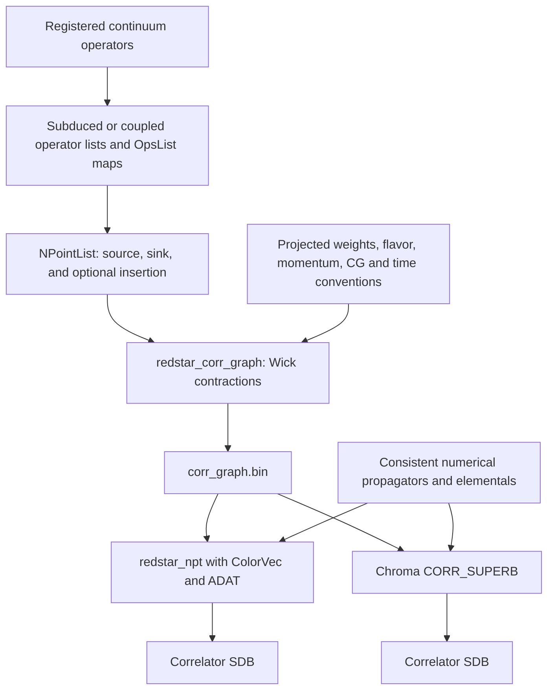

# Redstar primer: continuum operators to numerical correlators

**Use devel as the regression baseline. `no_1pt` is experimental.** This primer follows the working Redstar → corr_graph → NPT/CORR_SUPERB pipeline. It separates choosing a correlation function from supplying the numerical data needed to evaluate it.

## The pipeline



The graph says **what to contract**. Propagators, elementals and evaluation settings supply **the numbers and runtime conditions**. Operator generation and graph construction require no numerical SDBs.

| Object | What it contains |
|---|---|
| Continuum operator name | A registered construction, such as `pion_pionxD0_J0__J0`. Discover names with Redstar's operator-list tools. |
| Operator `.list` and `OpsList` XML | Subduced/coupled names plus their definitions. Keep both outputs. |
| Projected-operator weights | Definitions of linear combinations used by projected constituents; supplied separately when required. |
| `NPointList` | Requested correlators: operator choices, flavors, rows, momenta, creation/smearing flags and times. |
| `corr_graph.bin` | Reusable Wick-contraction graphs and vertex coefficients, written by the matching graph generator. |
| Propagator/perambulator data | Quark propagation projected onto the chosen distillation basis. |
| Elementals | Spatial operator tensors built from eigenvectors, derivatives/displacements and momentum phases. |
| GenProp data | Generalized propagators containing an unsmeared current insertion between propagator legs. |
| Correlator SDB | The assembled numerical time series, with complete operator keys. An XML run report is a different output. |

An N-point function counts operator insertion points, not the number of hadrons inside each operator. An Nπ source and Nπ sink form a two-point function; adding a current gives a three-point function. One requested correlator can expand into many Wick-contraction graphs.

## 1. Choose continuum operators and quantum numbers

A continuum name is an input to operator construction. Its lattice descendants have momentum-dependent little-group irreps and rows; a generated name is not another continuum input. For multiparticle operators, specify constituents and couple their momenta and irreps. Preserve the generated map instead of reconstructing a name by hand.

Flavor fields such as `twoI`, `threeY` and `twoI_z` select the channel; irrep and row specify its lattice transformation properties. CG coefficients couple constituent operators to the requested total quantum numbers. These choices are distinct from the numerical flavor-to-mass mapping.

Two useful routes are:

- `generate_redstar_onehadron`: subduce registered one-hadron continuum operators over a momentum-squared range.
- `generate_all_possible_nonint_spectrum`: enumerate allowed two-hadron combinations from a mass table and quantum-number selection. It produces an operator list, `OpsList`, and an energy report. Filter the intended basis explicitly; an energy cutoff is not a license to use every raw candidate.

Spectrum masses and anisotropy used to select a basis do not change the quark-action masses in the numerical data. For example, the [Roper/Nπ workflow](https://github.com/JeffersonLab/redstar/blob/devel/docs/roper/README.md) selects a basis using L=12; that basis was evaluated on both a compact 4³×16 test lattice and the original 12³×16 lattice. These are distinct numerical tests.

Detailed interfaces: [one-hadron generation](https://github.com/JeffersonLab/redstar/blob/devel/docs/generate_redstar_onehadron.md), [explicit two-hadron generation](https://github.com/JeffersonLab/redstar/blob/devel/docs/generate_redstar_twohadron.md), and [all-possible spectrum generation](https://github.com/JeffersonLab/redstar/blob/devel/docs/generate_all_possible_nonint_spectrum.md).

## 2. A small devel example: a continuum pion through corr_graph

Set the following paths to your checkouts and a compatible **devel** tool installation. Use one compiler/library stack within each executable; the [build guide](https://github.com/JeffersonLab/redstar/blob/devel/docs/build.md) describes supported setups.

```sh
kanoni=/path/to/redstar_kanoni.devel
redstar=/path/to/redstar.devel
export REDSTAR_BIN=/path/to/devel/install/bin
```

Run these blocks in the same shell. They create a fresh working directory; relative XML filenames resolve from that directory.

```sh
mkdir -p "$kanoni/runs"
primer_run=$(mktemp -d "$kanoni/runs/primer-pion.XXXXXX")
cd "$primer_run"
printf '%s\n' pion_pionxD0_J0__J0 > continuum.list
"$REDSTAR_BIN/generate_redstar_onehadron" \
  0 0 onehadron.list onehadron.xml < continuum.list > onehadron.log 2>&1
```

Here `0 0` selects zero momentum only. The bounds are inclusive integer momentum squared, with spatial momentum in units of 2π/L. The generated list has one record:

```text
000_A1mM pion_pionxD0_J0__J0_A1__000
```

Next request a source/sink pair at source time zero:

```sh
cat > two_point.ini.xml <<'XML'
<GenerateXML>
  <runmode>default</runmode>
  <include_all_rows>false</include_all_rows>
  <default_row>1</default_row>
  <moms><elem>0 0 0</elem></moms>
  <t_sources>0</t_sources>
  <sink_ops_list>onehadron.list</sink_ops_list>
  <source_ops_list>onehadron.list</source_ops_list>
  <ops_xmls><elem>onehadron.xml</elem></ops_xmls>
</GenerateXML>
XML
"$REDSTAR_BIN/generate_redstar_2pt" \
  two_point.ini.xml npoint.xml > two_point.log 2>&1
```

`runmode=default` forms source/sink products within matching irrep/row sectors. Here the basis has one operator, so there is one correlator. A larger basis can produce a whole matrix.

`npoint.xml` is a standalone `NPointList`. Insert it into a complete graph input:

```sh
python3 - "$redstar" <<'PY'
from pathlib import Path
import sys
import xml.etree.ElementTree as ET
repo = Path(sys.argv[1])
tree = ET.parse(repo / 'src/redstar_corr_graph.ini.xml')
root = tree.getroot()
root.remove(root.find('NPointList'))
root.insert(1, ET.parse('npoint.xml').getroot())
root.find('DBFiles/corr_graph_bin').text = 'corr_graph.bin'
tree.write('graph.ini.xml', encoding='utf-8', xml_declaration=True)
PY
"$REDSTAR_BIN/redstar_corr_graph" \
  graph.ini.xml graph.out.xml > graph.log 2>&1
"$REDSTAR_BIN/view_corr_graph" corr_graph.bin > graph.summary.md
```

This example was checked for the primer: **one correlator, one evaluatable graph, graph format 3, layout 4×4×4×16 and Nt_corr=16**. The template supplies v14 parameters and an empty projected-weight list, appropriate for this built-in pion.

| File | Meaning |
|---|---|
| `onehadron.xml` | Operator definitions; root `OpsList`. |
| `npoint.xml` | Requested correlator; root `NPointList`. |
| `graph.ini.xml` | Complete graph input; root `RedstarNPt`, `Param/version=14`. |
| `graph.out.xml` | Graph-construction report. |
| `corr_graph.bin` | Binary numerical-evaluator input. |

An `OpsList`, a `NPointList`, the XML input version, and the binary graph version are separate things. `NPointList` belongs directly under `RedstarNPt`, outside `Param`. Other generators have their own schemas; do not change every XML version to 14.

## 3. Time, momentum and operator conventions

The common two-point ordering is sink then source: sink `t_slice=-2`, source `t_slice=0`. A negative value refers to another N-point's time as the origin for the varying point; it is not a literal negative lattice coordinate. A common three-point arrangement is sink 6, insertion -3, source 0: the insertion moves relative to the source. Keep the established input's convention when adapting a case.

`Nt_corr` and `Nt_forward` are sample counts. Seven samples from source zero cover 0–6. `t_origin` shifts the evaluation origin with temporal wrapping. A fixed one-point component can multiply a time-dependent component; it must retain its fixed time rather than move with the parent correlator.

`mom_class` identifies the canonical operator momentum class; `Irrep/irmom/mom` gives the requested actual momentum. Couple and rotate constituent momenta jointly. Explicit quark phasings, creation flags, smearing flags and CG settings affect the calculation and must survive input preparation. See [phasing](https://github.com/JeffersonLab/redstar/blob/devel/docs/phasing.md).

Projected constituent names require their weight XML files in `DBFiles/proj_op_xmls`. Loading an `OpsList` does not supply those weights. Use the typed weight converter for old formats; renaming momentum tags is not a representation conversion.

## 4. Evaluate the pion graph with NPT

NPT evaluates the graph using ColorVec/ADAT database readers. Its separate numerical XML supplies `Param`, `DBFiles` and `ColorVec`, including vector count, flavor-to-mass mapping and database lists. The graph has already selected the operators.

The public immutable **kanoni-v1 legacy-SDB dataset** covers this simple pion. This is separate from the newer native-double dataset used in the matched comparisons below.

```sh
cd "$kanoni"
./setup-data
cd "$primer_run"
python3 "$redstar/scripts/prepare_npt_input.py" \
  "$redstar/src/redstar_npt.ini.xml" npt.ini.xml \
  --database-dir "$kanoni/data" \
  --graph-bin "$primer_run/corr_graph.bin" \
  --output-db "$primer_run/output.sdb1"
"$REDSTAR_BIN/redstar_npt" npt.ini.xml npt.out.xml > npt.log 2>&1
```

The helper rebases database paths into a fresh numerical input. `fake_data_modeP` remains false. This example was checked with independent readback: **one stored correlator, one configuration and 16 finite complex samples**.

NPT needs the data actually required by the graph: perambulators, meson/baryon elementals and, for applicable insertions, GenProps or disconnected blocks. Flavor labels such as `l` map to database mass strings such as `U0.05`; they do not retune a propagator. A missing key is a missing-data/support problem to diagnose, not a reason to change an operator or mass until the program exits successfully.

## 5. Evaluate graphs with Chroma/CORR_SUPERB

CORR_SUPERB is an inline measurement in an ordinary Chroma job. It reads `corr_graph.bin` and uses the shared contraction backend. The job still supplies the gauge configuration, color vectors, mass/solver configuration, input tensor files and output name.

The central fields in the measurement's input are:

| Section | Supplies |
|---|---|
| Job `Cfg` and `RNG` | The actual gauge setup; the native regression recipes use WEAK_FIELD with the recorded seed. |
| `Param/num_vecs`, `t_origin`, `Nt_forward` | Evaluation rank and time window, matching NPT. |
| `Param/flavor_to_mass`, `flavor_to_prop` | Database labels and configured fermion actions/solvers. |
| `Param/props`, `mesons`, `baryons`, `genprops` | Lists of saved numerical objects. |
| `NamedObject/colorvec_files` | The matching color-vector MOD file(s). |
| `NamedObject/corr_graph_file`, `corr_file` | Graph input and correlator database output. |

These are fields within a complete Chroma job, not a standalone executable XML fragment. The supplied [shared Chroma template](../regressions/corr_superb/chroma.xml) demonstrates the job structure. Its historical Nπ mode generates fresh eigenvectors and computes missing objects on demand. It is not interchangeable with a saved-field direct comparison.

Once a complete input is staged, the invocation is simply:

```sh
/path/to/chroma -i chroma.xml -o chroma.out.xml > chroma.log 2>&1
```

A job can share its structure across graph cases, but vector count, time window, flavors and available data must still match the selected case. The `pion_3pt` regression, for example, requests **two** vectors; supplying ten changes the calculation.

### Stored tensors for direct NPT/CORR comparison

Use the same gauge, eigenvectors, propagators and operator data on both sides. Regenerating eigenvectors independently can choose a different basis; matching dimensions or eigenvalues alone does not prove matching tensors. Preserve the exact MOD files and checksums with the dataset.

The validated native-double recipe uses MOD64 color vectors, RsdCG=1e-14, separate `prop-U*.sbt` and GenProp files per mass, and meson momentum coverage through mom2=4. `.sbt` denotes native SUPERB tensor storage; `.sdb`/`.sdb1` are legacy/keyed databases in these examples. A suffix change does not convert a file. Use the native inspection/readback tools for tensors and ADAT database tools for correlator SDBs.

In the matched regression jobs, CORR_SUPERB reads the saved propagators and GenProps: **all 58 comparison jobs performed zero CG solves**. Solver configuration remains available for missing objects; a comparison unexpectedly performing inversions needs investigation. The full on-demand GenProp path has separate unresolved diagnostics and is not validated by these stored-tensor results.

Do not compare the legacy numerical result from section 4 directly to a newly generated native dataset and attribute differences only to contractions. Use the matched dataset workflow below. [Dataset recipes and provenance](../chroma_inputs/README.md) explain the separate dataset, retained legacy exception and metadata pins. The new payloads are not distributed by `setup-data` as a new public release.

## 6. Run the supplied workflows

From the Kanoni checkout, the three small entry points implement the requested separation:

```sh
cd "$kanoni"
python3 scripts/run_corr_graph.py regressions/redstar/pion \
  --redstar-bin "$REDSTAR_BIN"
```

This graph-only command requires no SDBs. For the numerical wrappers, configure compatible tools using [contraction-tools.example.toml](../regressions/contraction-tools.example.toml):

```sh
cp regressions/contraction-tools.example.toml regressions/contraction-tools.local.toml
# Edit the local file to select your actual executables.
python3 scripts/run_redstar_npt.py regressions/redstar/pion \
  --tools regressions/contraction-tools.local.toml
python3 scripts/run_corr_superb.py regressions/corr_superb/npi_001_E1 \
  --tools regressions/contraction-tools.local.toml --threads 1
```

Each wrapper makes its own fresh run directory and checks its own trusted reference. Numerical reference SDBs are Git-ignored and must be restored at the checksum-pinned locations before using these wrappers; `setup-data` does not download those extra outputs. The NPT pion case and CORR Nπ case above are different examples, not a direct pair. See [split workflows](../regressions/CONTRACTIONS.md) for reference locations and arguments.

For a **direct matched native-tensor** comparison, use `compare_regression_chains.py`. It generates a graph, runs NPT, runs Chroma, and independently checks their outputs. Supply actual tool paths and the generated dataset directory, which includes its manifest and recorded `inputs/colorvec.ini.xml`:

```sh
python3 scripts/compare_regression_chains.py \
  --dataset /path/to/native-double-data \
  --output runs/my-new-pion-comparison \
  --baseline-graph-bin /path/to/devel/bin \
  --baseline-npt /path/to/devel/bin/redstar_npt \
  --baseline-chroma /path/to/devel/chroma \
  --feature-graph-bin /path/to/no_1pt/bin \
  --feature-npt /path/to/no_1pt/bin/redstar_npt \
  --feature-chroma /path/to/no_1pt/chroma \
  --dbutil /path/to/adat/bin/dbutil \
  --exporter /path/to/safe-export-correlators \
  --qualification 'record the actual source revisions, compiler and build' \
  --cases pion
```

This runs both chains; no_1pt output is labelled experimental. Add `--chain devel` to evaluate only the baseline; the current CLI still requires both sets of tool paths. Omit `--cases` for the complete inventory. Use `--npt-only --cases glue tetra_F27_S2 fsq_3pt` for the separate NPT lanes whose CORR implementations are deferred. Run `--help` for resource limits and options. Build the numbered exporter with `scripts/build_exporter.py --adat-config /path/to/adat-config --output /path/to/new-exporter`.

## 7. Add three-point functions and larger bases

`generate_redstar_3pt` adds a source, insertion and sink, with their momenta, times and creation/smearing conventions. It enforces the specified momentum relation. A three-point list still goes through the same graph stage; it also requires the relevant insertion data at numerical evaluation. See the [three-point generator guide](https://github.com/JeffersonLab/redstar/blob/devel/docs/generate_redstar_3pt.md).

The recent meson three-point fixes cover reversed GenProp lookup through gamma-five hermiticity and diagonal GenProps with equal endpoint times. Equal endpoints retain the full diagonal insertion tensor; they are not a zero-length support interval. `pi_pi_3pt`, `pion_3pt` and all 189 `rho_rho_3pt` values now pass matched checks on both chains. [The investigation](three-point-comparison.md) records the failures and fixes.

For larger examples, follow the [a1 continuum-to-correlator workflow](https://github.com/JeffersonLab/redstar/blob/devel/docs/a1_workflow.md), the [Nπ/Roper workflow](https://github.com/JeffersonLab/redstar/blob/devel/docs/roper/README.md), and the [rho–rho three-point example](https://github.com/JeffersonLab/redstar/blob/devel/src/generate_all_3pt_spectrum/rho_rho/README.md). Fitting and extraction of physical form factors are later stages; the [development summary](development-summary.md) links the matelem_fitter end-to-end example.

## 8. What constitutes a passing calculation?

Check exact operator-key coverage, configuration/time shapes, finite full numerical readback and a closed correlator database. Inspect logs for missing keys and unsupported graphs. An exit code of zero or a nonempty XML report is insufficient. Keep the declared exact-zero isospin control separate from positive channels.

For paired native checks, the unchanged gate is applied to every complex value:

```text
abs(NPT - CORR) <= 1e-9 * max(abs(NPT), abs(CORR))
                  + 1e-12 * max(reference_global_max, 1e-30)
```

`dbutil keysxml` and the numbered exporter provide independent coverage/readback. The runner retains the additional relative-only `dbutil compare` diagnostic; it does not replace the per-value test. Historical fixed-baseline runners have their own pinned tolerances and should not be silently reconfigured.

On 3 November 2026, separate full native-double sweeps passed 30 active matched cases per chain, including `nuc_nuc_3pt` with the validated direct-DISCO supplement: see the [merged devel report](arb-native-regressions.md) and [experimental no_1pt report](no1pt-native-regressions.md). Devel remains the baseline and no_1pt remains experimental. The historical 29-case matrix and earlier targeted DISCO checks remain separate evidence. Glue/tetra CORR support and gluonic-insertion comparisons are deferred; their native storage and NPT checks are separate. `ff_3pt` remains deferred. See [disconnected loops](disconnected-loops.md), [coverage and scope](regressions.md) and [regression-policy.json](regression-policy.json) before extending the inventory.

The earlier full sweeps use incremental corrected **pre-YLM** binaries. The subsequent [clean experimental build](no1pt-clean-build.md) freshly compiled matching no_1pt branches with three documented ADAT source backports and passed all 30 active cases. Its Chroma uses fresh MPI ADAT at one rank; NPT uses fresh CPU ADAT from the same source. This does not validate multi-rank MPI, GPU, on-demand GenProp or a general all-YLM migration. Devel remains the baseline and retains its recorded build qualification. A single weak-field configuration checks software behavior, not ensemble uncertainties or physical masses.

## 9. Keep no_1pt experimental

| Chain | Binary graph format used here | Role |
|---|---:|---|
| devel | 3 | Regression baseline and source of accepted baseline references. |
| no_1pt | 4 | Separate experimental graph generator, evaluator and output. |

Both use RedstarNPt XML version 14. Regenerate graphs with the matching chain; the wire formats are incompatible.

In experimental no_1pt, `average_1pt_diagrams=false` disables full-lattice one-point averaging; it does **not** discard all one-point contributions. Fixed pieces and pieces varying within the parent's requested window are still evaluated. Experimental CORR_SUPERB currently accepts false and rejects true as unsupported. Devel's legacy averaging and zero-unsmeared choices must likewise match between the graph/numerical inputs and the comparison job. These settings change the calculation; do not toggle them to hide a failure.

Keep experimental results separate from devel baselines even after they agree numerically. The [experimental one-point guide](https://github.com/JeffersonLab/redstar/blob/devel-rge-no_1pt/docs/onept-time-windows.md) describes the feature in more detail.
